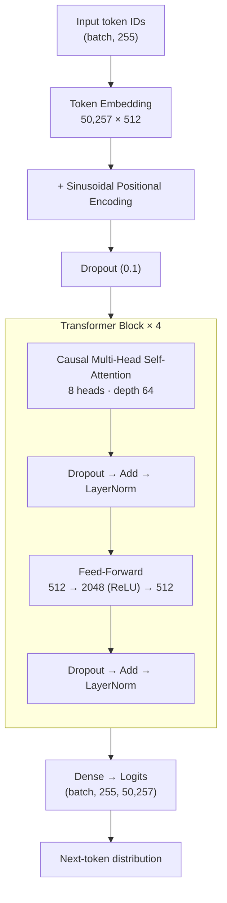
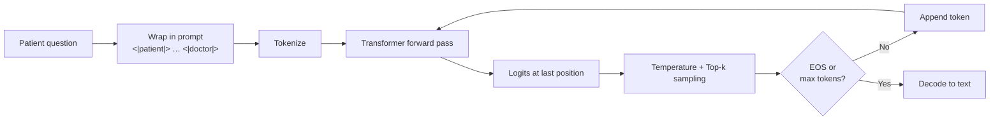

<div align="center">

# 🩺 ChatDoc-AI

### A decoder-only Transformer, built from scratch in TensorFlow/Keras, for medical dialogue generation

[](https://www.python.org/)
[](https://www.tensorflow.org/)
[](https://keras.io/)
[](https://huggingface.co/docs/transformers)
[](https://streamlit.io/)
[](https://huggingface.co/datasets/lavita/ChatDoctor-HealthCareMagic-100k)
[](LICENSE)
[](#-disclaimer)

**64M parameters · 4 layers · 8 heads · trained on ~52K doctor–patient conversations**

[Overview](#-overview) •
[Architecture](#-model-architecture) •
[Results](#-results) •
[Quick Start](#-quick-start) •
[Training](#-training-pipeline) •
[Limitations](#-known-limitations) •
[Roadmap](#-roadmap)

</div>

---

> [!CAUTION]
> ## ⚠️ Disclaimer
> **ChatDoc-AI is an educational and research project. It is NOT a medical device and must NOT be used for diagnosis, treatment, or any real medical decision.**
> The model frequently produces fluent but **medically incorrect or hallucinated** text (see [Limitations](#-known-limitations)). Always consult a qualified healthcare professional.

---

## 📌 Table of Contents

- [Overview](#-overview)
- [Highlights](#-highlights)
- [Model Architecture](#-model-architecture)
- [Dataset](#-dataset)
- [Training Pipeline](#-training-pipeline)
- [Results](#-results)
- [Example Outputs](#-example-outputs)
- [Project Structure](#-project-structure)
- [Quick Start](#-quick-start)
- [Inference & Decoding](#-inference--decoding)
- [Configuration Reference](#-configuration-reference)
- [Known Limitations](#-known-limitations)
- [Roadmap](#-roadmap)
- [Troubleshooting](#-troubleshooting)
- [References](#-references)
- [License](#-license)
- [Author](#-author)

---

## 🔍 Overview

**ChatDoc-AI** is a conversational AI that generates doctor-style replies to patient questions. Instead of fine-tuning a pretrained LLM, the Transformer is **implemented from scratch** with low-level Keras layers (positional encoding, causal multi-head self-attention, residual blocks, layer norm) and trained end-to-end on the public **ChatDoctor-HealthCareMagic-100k** dataset.

The project is a complete, reproducible pipeline:

```
Data loading → Cleaning → Tokenization → Model → Masked-loss training → Evaluation → Streamlit app
```

It is designed as a **learning-oriented reference** for anyone who wants to understand how a GPT-style language model works internally, rather than as a production medical system.

---

## ✨ Highlights

| | Feature |
|---|---|
| 🧱 | **From-scratch Transformer**: custom `AddPositionalEncoding`, `CausalSelfAttention`, `TransformerBlock` layers, no pretrained weights |
| 🎭 | **Causal masking** with `tf.linalg.band_part`, so the model never attends to future tokens |
| 🧮 | **Padding-aware loss & accuracy**: custom `masked_loss` / `masked_accuracy` that ignore padded positions (`PAD_LABEL = -100`) |
| 🔤 | **GPT-2 BPE tokenizer** (50,257 tokens) via 🤗 `GPT2TokenizerFast` |
| 🎲 | **Sampling decoder** with temperature + top-k for more natural replies |
| 📊 | **Multi-metric evaluation**: loss, perplexity, token accuracy, ROUGE-1/2/L, BERTScore |
| 🖥️ | **Streamlit chat UI** with chat history and a clear-chat button |
| ♻️ | **Reproducible**: fixed seeds (`42`), deterministic 70/15/15 split |
| 📦 | **GitHub-friendly model storage**: weights are split into `part_*` chunks and reassembled at runtime |

---

## 🏗️ Model Architecture

A **decoder-only (GPT-style) Transformer** with post-layer-norm residual blocks.



### Hyperparameters

| Parameter | Value |
|---|---|
| Layers | 4 |
| Attention heads | 8 (head depth = 64) |
| Model dimension (`d_model`) | 512 |
| Feed-forward dimension | 2048 |
| Activation | ReLU |
| Dropout | 0.1 |
| Context length | 255 tokens (`MAX_LENGTH − 1`) |
| Vocabulary size | 50,257 (GPT-2 BPE) |
| Positional encoding | Fixed sinusoidal |
| **Total parameters** | **64,122,961 (~244.6 MB, float32)** |

The token embedding alone accounts for ~25.7M parameters, and the output projection adds another ~25.8M; the 4 transformer blocks hold the remainder.

### Prompt Format

Each training example is serialized as a single sequence so the model learns to continue a patient question with a doctor answer:

```
<|patient|> {patient question} <|doctor|> {doctor answer}<|endoftext|>
```

The model is trained with standard **next-token prediction** (inputs shifted by one position), and only the tokens of the whole sequence that are not padding contribute to the loss.

---

## 📚 Dataset

| | |
|---|---|
| **Name** | [`lavita/ChatDoctor-HealthCareMagic-100k`](https://huggingface.co/datasets/lavita/ChatDoctor-HealthCareMagic-100k) |
| **Source** | Real patient questions and doctor replies collected from HealthCareMagic |
| **Full size** | 112,165 conversations |
| **Used here** | First **75,000** → **74,995** after dropping empty pairs |
| **Fields used** | `input` (patient) → `output` (doctor) |

### Split

| Split | Ratio | Samples |
|---|---|---|
| Train | 70% | 52,496 |
| Validation | 15% | 11,249 |
| Test | 15% | 11,250 |

The split is done with `train_test_split(random_state=42)` for full reproducibility.

---

## 🏋️ Training Pipeline


### Training Configuration

| Setting | Value |
|---|---|
| Optimizer | Adam (`lr = 3e-4`, `clipnorm = 1.0`) |
| Loss | Masked sparse categorical cross-entropy (`from_logits=True`) |
| Batch size | 16 |
| Max epochs | 10 |
| Callbacks | `EarlyStopping(patience=2, restore_best_weights=True)`, `ReduceLROnPlateau(factor=0.5, patience=1, min_lr=1e-4)` |
| Shuffle buffer | 10,000 |
| Hardware | Google Colab GPU |
| Time | ≈ 1,240 s / epoch (≈ 3.4 h total) |

### Training Curve

| Epoch | Train Loss | Val Loss | Train Acc | Val Acc |
|:---:|:---:|:---:|:---:|:---:|
| 1 | 5.5062 | 4.7128 | 15.85% | 22.58% |
| 2 | 4.4582 | 4.0790 | 24.92% | 29.48% |
| 3 | 3.9929 | 3.7854 | 29.88% | 32.97% |
| 4 | 3.7324 | 3.6095 | 32.72% | 35.06% |
| 5 | 3.5585 | 3.5002 | 34.59% | 36.52% |
| 6 | 3.4295 | 3.4277 | 36.00% | 37.55% |
| 7 | 3.3287 | 3.3570 | 37.06% | 38.35% |
| 8 | 3.2467 | 3.3128 | 37.92% | 38.98% |
| 9 | 3.1778 | 3.2760 | 38.66% | 39.46% |
| 10 | 3.1196 | 3.2448 | 39.27% | 39.94% |

> 📈 Validation loss was **still decreasing at epoch 10** and `EarlyStopping` never triggered, so the model is **under-trained**. Longer training should improve results.

---

## 📊 Results

### Test Set (11,250 samples)

| Metric | Score |
|---|:---:|
| **Test loss** | 3.2464 |
| **Perplexity** | **25.70** |
| **Token accuracy** | 39.79% |

### Generation Quality (50 test samples)

| Metric | Score |
|---|:---:|
| ROUGE-1 (F1) | 0.2724 |
| ROUGE-2 (F1) | 0.0499 |
| ROUGE-L (F1) | 0.1590 |
| BERTScore Precision | 0.8452 |
| BERTScore Recall | 0.8346 |
| **BERTScore F1** | **0.8397** |

> **How to read these numbers**
> - **Perplexity ≈ 25.7** means the model is, on average, as uncertain as choosing between ~26 equally likely tokens.
> - **BERTScore** was computed with `roberta-large` **without baseline rescaling**, so absolute values are inflated. Compare it only against other runs using the same setup.
> - ROUGE/BERTScore were measured on only **50 samples** and should be treated as indicative, not definitive.
> - None of these metrics measure **medical correctness**. Clinical accuracy requires expert human evaluation.

---

## 💬 Example Outputs

**Prompt**
```
I have headache . what should i do ?
```

**Model reply** *(sampled, temperature 0.8, top-k 40)*
```
Hi, Thanks for writing to Chat Doctor. I am Chat Doctor. It is unusual to have
headache with headache, and headache. You are suffering from severe headache from
migraine. ... You should consult an ENT surgeon and get investigated thoroughly ...
```

The model has clearly learned the **style, structure, and vocabulary** of doctor replies (greetings, "Thanks for writing to Chat Doctor", lists of investigations), but the **content is unreliable**: it repeats itself and makes unfounded clinical claims. This is expected for a small model trained from scratch, and it is exactly why this project is **not** for real medical use.

---

## 📁 Project Structure

```
ChatDoc-AI/
├── 📓 Jupyter_Notebook.ipynb     # Full pipeline: data → train → evaluate → save
├── 🖥️ app.py                     # Streamlit chat application
├── 📋 requirements.txt           # Python dependencies
├── 📜 LICENSE                    # MIT License
├── 📖 README.md                  # You are here
└── 📦 artifacts/
    ├── config.json               # Hyperparameters used for training
    ├── tokenizer/                # Saved GPT-2 tokenizer files
    ├── model_parts/              # Model weights split into chunks
    │   ├── part_000
    │   ├── part_001
    │   └── ...
    └── medical_transformer.keras # Rebuilt automatically from model_parts/ on first run
```

> 💡 **Why split the model?** GitHub rejects files larger than 100 MB. The `.keras` file (~245 MB) is therefore stored as ordered `part_*` chunks. `app.py` concatenates them back into `medical_transformer.keras` the first time it runs.

---

## 🚀 Quick Start

### Prerequisites

- Python **3.10+**
- ~2 GB free RAM for inference
- (Optional) NVIDIA GPU for faster generation

### 1. Clone the repository

```bash
git clone https://github.com/mahanliaghatmand/ChatDoc-AI.git
cd ChatDoc-AI
```

### 2. Create a virtual environment

```bash
python -m venv .venv

# Linux / macOS
source .venv/bin/activate

# Windows (PowerShell)
.venv\Scripts\Activate.ps1
```

### 3. Install dependencies

```bash
pip install --upgrade pip
pip install -r requirements.txt
```

### 4. Run the app

```bash
streamlit run app.py
```

Open **http://localhost:8501** in your browser. The first launch rebuilds the model from its chunks and may take a few minutes.

### Reproduce the training (Google Colab)

1. Upload `Jupyter_Notebook.ipynb` to [Google Colab](https://colab.research.google.com/).
2. Select **Runtime → Change runtime type → GPU**.
3. Run all cells. The notebook will:
   - install dependencies and mount Google Drive,
   - download the dataset and build the splits,
   - train the model (~3.4 h on a Colab GPU),
   - evaluate and save artifacts to `MyDrive/MedicalChatbot/`.

---

## 🧠 Inference & Decoding

Generation is **autoregressive**: the model predicts one token at a time and feeds it back as input.



| Decoding parameter | Default | Effect |
|---|:---:|---|
| `temperature` | 0.8 | Lower = safer and more repetitive; higher = more diverse and more error-prone. `0` = greedy |
| `top_k` | 40 | Sample only from the 40 most probable tokens |
| `max_new_tokens` | 100 | Upper bound on reply length |
| Context window | 255 | Longer prompts keep only the most recent tokens |

### Minimal programmatic usage

```python
reply = generate_reply(
    model, tokenizer,
    "I have a sore throat and mild fever for two days.",
    max_new_tokens=100,
    temperature=0.8,
    top_k=40,
)
print(reply)
```

> ⚙️ For loading the saved model, the three custom layers (`AddPositionalEncoding`, `CausalSelfAttention`, `TransformerBlock`) must be importable and passed via `custom_objects`. See [Troubleshooting](#-troubleshooting).

---

## ⚙️ Configuration Reference

All training hyperparameters live in the notebook config cell and are saved to `artifacts/config.json`.

| Key | Value | Description |
|---|:---:|---|
| `NUM_SAMPLES` | 75000 | Dataset rows used |
| `MAX_LENGTH` | 256 | Max sequence length (model context = 255) |
| `DMODEL` | 512 | Embedding / hidden size |
| `NUM_HEADS` | 8 | Attention heads |
| `FF_DIM` | 2048 | Feed-forward hidden size |
| `NUM_LAYERS` | 4 | Transformer blocks |
| `DROPOUT` | 0.1 | Dropout rate |
| `PAD_LABEL` | -100 | Label value ignored by the loss |

Additional notebook-only constants: `BATCH_SIZE=16`, `EPOCHS=10`, `LR=3e-4`, `NUM_EVAL=50`, `SEED=42`.

---

## ⚠️ Known Limitations

Being transparent about weaknesses is part of good ML engineering:

- **🩻 Medical unreliability.** The model hallucinates diagnoses and recommendations. It must never be used for real health decisions.
- **🔁 Repetition & incoherence.** Phrases and words repeat (e.g. "headache with headache, and headache"), typical for small, under-trained language models.
- **🪞 Style over substance.** It imitates the dataset's tone (including boilerplate like "Thanks for writing to Chat Doctor") without genuine medical understanding.
- **📉 Under-trained.** Validation loss was still dropping after 10 epochs.
- **🧹 Noisy data.** The raw dataset contains inconsistent, sometimes low-quality or ALL-CAPS answers, which can leak into outputs. No cleaning step is applied yet.
- **📏 Limited context.** A 255-token window truncates long patient histories.
- **🐢 Slow inference.** Each generated token recomputes a full forward pass over the padded sequence (no KV-cache).
- **🌐 English only.** Trained exclusively on English text.
- **📐 Small evaluation set.** ROUGE/BERTScore use only 50 samples; BERTScore is not baseline-rescaled.
- **🔤 Prompt markers are plain text.** `<|patient|>` and `<|doctor|>` are tokenized as ordinary sub-word tokens, not dedicated special tokens.

---

## 🗺️ Roadmap

- [ ] Fix and finalize `app.py` (register custom layers, match the notebook's decoder-only generation and prompt format)
- [ ] Add `@register_keras_serializable` and `get_config()` to all custom layers
- [ ] Register `<|patient|>` / `<|doctor|>` as real special tokens
- [ ] Clean the dataset (remove ALL-CAPS, very short and boilerplate-heavy answers, deduplicate)
- [ ] Train longer (20–30 epochs) with a proper LR schedule (warm-up + cosine decay)
- [ ] Scale `d_model` embeddings by `√d_model`; try pre-LN and GELU
- [ ] Add KV-cache for faster generation, plus nucleus (top-p) sampling and repetition penalty
- [ ] Evaluate on ≥ 500 samples with baseline-rescaled BERTScore
- [ ] Add human / expert evaluation of medical correctness
- [ ] Compare against fine-tuned GPT-2 / DistilGPT-2 baselines
- [ ] Dockerfile + deployment to Hugging Face Spaces
- [ ] Unit tests (masking, loss, positional encoding)

---

## 🛠️ Troubleshooting

<details>
<summary><b>❓ <code>ValueError: Unknown layer: AddPositionalEncoding</code> (or TransformerBlock / CausalSelfAttention)</b></summary>

The `.keras` file contains custom layers, so Keras needs their definitions at load time. Copy the three layer classes from the notebook into `app.py` and pass them in:

```python
CUSTOM_OBJECTS = {
    "AddPositionalEncoding": AddPositionalEncoding,
    "CausalSelfAttention": CausalSelfAttention,
    "TransformerBlock": TransformerBlock,
}
model = tf.keras.models.load_model(MODEL_PATH, custom_objects=CUSTOM_OBJECTS, compile=False)
```

Layers should also implement `get_config()` to be serialized reliably.
</details>

<details>
<summary><b>❓ <code>OSError</code> / tokenizer not found on Linux</b></summary>

Linux file systems are case-sensitive. The notebook saves the tokenizer to `artifacts/tokenizer/` (lowercase), so make sure `TOKENIZER_PATH` in `app.py` uses the **exact same casing** as your folder name.
</details>

<details>
<summary><b>❓ <code>FileNotFoundError: No model parts found</b></code></summary>

Ensure `artifacts/model_parts/` contains the `part_000`, `part_001`, … files and that they were pushed to GitHub (check `.gitignore` and file-size limits).
</details>

<details>
<summary><b>❓ Output is gibberish or empty</b></summary>

Generation in the app must match the notebook exactly: same prompt format (`<|patient|> … <|doctor|>`), **single-input** decoder-only forward pass, GPT-2 tokenizer, and EOS-based stopping. A seq2seq (encoder + decoder, two inputs) decoding loop will not work with this model.
</details>

<details>
<summary><b>❓ Generation is slow</b></summary>

There is no KV-cache, so cost grows with every token. Use a GPU, lower `max_new_tokens`, or wrap the forward pass in `tf.function` (as the notebook does).
</details>

<details>
<summary><b>❓ Out-of-memory during training on Colab</b></summary>

Lower `BATCH_SIZE`, reduce `MAX_LENGTH`, or reduce `NUM_SAMPLES`.
</details>

---

## 📖 References

- Vaswani et al., **"Attention Is All You Need"**, NeurIPS 2017. [arXiv:1706.03762](https://arxiv.org/abs/1706.03762)
- Radford et al., **"Language Models are Unsupervised Multitask Learners"** (GPT-2), 2019.
- Li et al., **"ChatDoctor: A Medical Chat Model Fine-tuned on a LLaMA Model using Medical Domain Knowledge"**, 2023. [arXiv:2303.14070](https://arxiv.org/abs/2303.14070)
- Zhang et al., **"BERTScore: Evaluating Text Generation with BERT"**, ICLR 2020. [arXiv:1904.09675](https://arxiv.org/abs/1904.09675)
- Lin, **"ROUGE: A Package for Automatic Evaluation of Summaries"**, 2004.
- Dataset: [lavita/ChatDoctor-HealthCareMagic-100k](https://huggingface.co/datasets/lavita/ChatDoctor-HealthCareMagic-100k)

---

## 📄 License

Distributed under the **MIT License**. See [`LICENSE`](LICENSE) for details.

The dataset is subject to its own license and terms on Hugging Face; please review them before any redistribution or commercial use.

---

## 👤 Author

**Mahan Liaghatmand**
GitHub: [@mahanliaghatmand](https://github.com/mahanliaghatmand)

---

<div align="center">

If this project helped you learn something, consider giving it a ⭐

*Built for learning. Not for diagnosing.* 🩺

</div>
